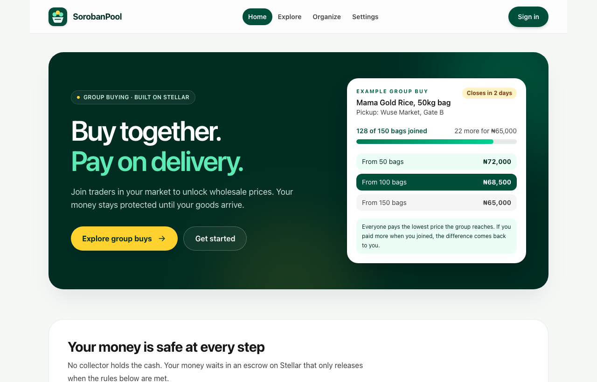
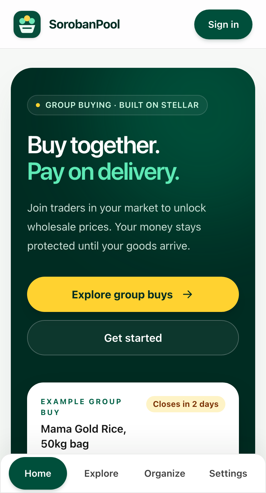
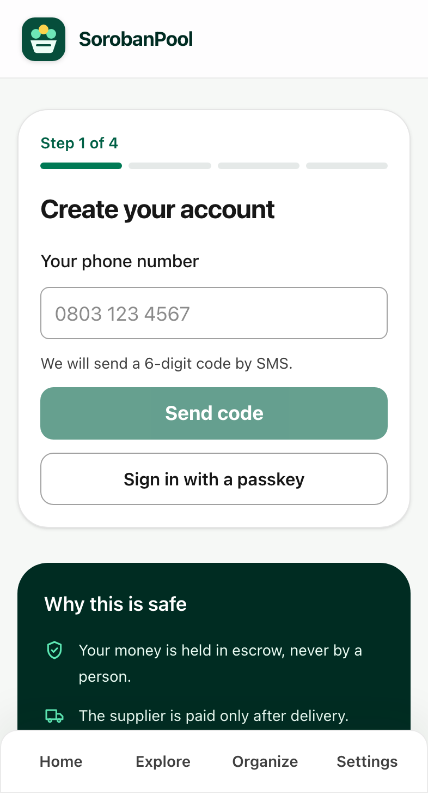
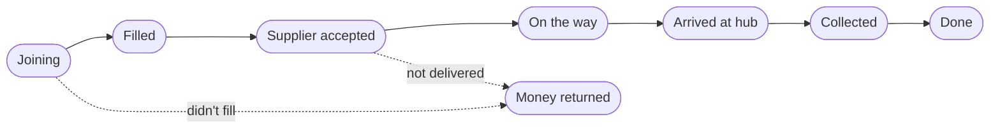
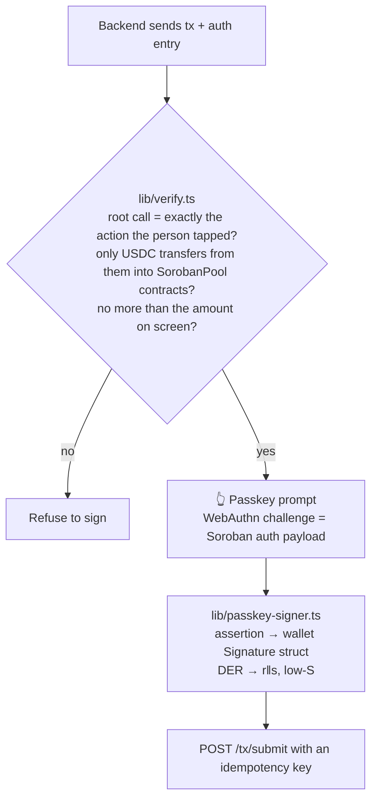

# sorobanpool-frontend

**Buy together. Pay on delivery.** The SorobanPool app: a mobile-first PWA for market traders and organizers, plus the supplier portal and the arbiter and admin consoles. Built on Stellar.

[](https://github.com/SorobanPool/sorobanpool-frontend/actions/workflows/ci.yml)


> Testnet only: practice money, no real payments. Live demo: [sorobanpool-frontend.vercel.app](https://sorobanpool-frontend.vercel.app)

Repos: [contracts](https://github.com/SorobanPool/sorobanpool-contracts) · [backend](https://github.com/SorobanPool/sorobanpool-backend) · **frontend** (this one). The product and architecture brief: [docs/brief.md](https://github.com/SorobanPool/sorobanpool-contracts/blob/main/docs/brief.md).

<p align="center">
  
</p>

<p align="center">
  
  &nbsp;&nbsp;
  
</p>

---

## Who it is for

Iya Bisi runs a provisions stall. She has an Android phone, patchy 3G and no interest in crypto. SorobanPool lets her join other traders to buy rice at the wholesale price, and her money is held safely until the bags reach her market. Every design decision starts from that:

- **No crypto jargon.** "Pay", "money held safely until delivery", "refund", "confirm with your fingerprint". Dollar amounts appear only where the price is fixed.
- **No seed phrase, no gas.** Her wallet is a passkey on her phone, and SorobanPool pays every network fee.
- **Built for a cheap phone in sunlight:** 360 px layouts, 48 px tap targets, a light theme, at most 170 KB of JavaScript on trader pages, an offline shell, and English and Nigerian Pidgin.
- **The trust message on every money screen:** *"Your money is held safely. The supplier is paid only after the goods arrive. If the group doesn't fill, you get everything back automatically."*

## The journey

```mermaid
flowchart LR
    A["📲 WhatsApp link<br/>to a pool"] --> B["Public pool page<br/>price ladder · progress · deadline"]
    B --> C["Phone + 6-digit code"]
    C --> D["Create wallet<br/>👆 one passkey prompt"]
    D --> E["Choose bags<br/>see: pay now · expected refund"]
    E --> F["👆 Confirm<br/>money into escrow"]
    F --> G["Live progress<br/>share to fill faster"]
    G --> H["Goods arrive at hub<br/>'I've collected'"]
    H --> I["Supplier paid<br/>refund of the price difference"]
```



Every pool page shows where the group is on its timeline:



## Signing safely

The backend builds every transaction, so the app treats it as untrusted and checks what it is about to sign:



- A compromised backend therefore cannot redirect funds. The app also refuses to sign at all unless `NEXT_PUBLIC_DEPLOYMENTS` (the real contract IDs) was baked in at build time.
- Nothing secret is stored in the browser: a passkey wallet keeps only its address. A synced passkey signs in and pays from a new phone with nothing to restore ([contracts ADR 0006](https://github.com/SorobanPool/sorobanpool-contracts/blob/main/docs/decisions/0006-passkey-smart-wallet.md)).
- On browsers without passkeys, a testnet-only fallback keeps a device key ([ADR 0001](docs/decisions/0001-device-wallet-and-signing-guard.md)).

## What is in the app

| Area | Screens |
|---|---|
| **Trader** | Home, Explore, public pool page (`/p/[slug]`, server-rendered for link previews), join and pay (USDC or naira), pool timeline with pickup, refund and "report a problem", History, Settings (language, passkeys) |
| **Organizer** | Create-pool wizard (offer, deadline, hub, pickup window, fee, market-only), organized pools, delivery confirmation with photo capture |
| **Supplier** | Onboarding, offers with naira tiers and a live USDC preview, pools to accept and dispatch, payout statement |
| **Arbiter** | Dispute queue sorted by SLA, dispute workspace with evidence and an outcome picker |
| **Admin** | Risk overview, KYB review, offer moderation, users and roles, disputes, audit log |

## Quickstart

```bash
pnpm install
cp .env.example .env.local
pnpm dev                                  # http://localhost:3000
```

To use real money flows against testnet, run the backend dev server (`SPONSOR_SECRET=S... pnpm dev:server` in [sorobanpool-backend](https://github.com/SorobanPool/sorobanpool-backend), port 3100), then build with the deployed contract IDs:

```bash
export NEXT_PUBLIC_API_URL=http://localhost:3100
export NEXT_PUBLIC_DEPLOYMENTS="$(jq -c '{usdc, contracts: (.contracts|map_values(.id))}' ../sorobanpool-contracts/deployments/testnet.json)"
pnpm build && pnpm exec next start -p 3101   # http://localhost:3101
```

On localhost the 6-digit code fills in by itself (dev mode), and "Create my wallet" makes a real passkey with your fingerprint, face or PIN.

## Testing

```bash
pnpm lint && pnpm typecheck && pnpm test     # 89 tests
SPONSOR_SECRET=S... pnpm test:e2e            # Playwright against the backend dev server and testnet
```

| Layer | Covers |
|---|---|
| Unit and component (Vitest, Testing Library) | money formatting, tier ladder, refund estimate, timeline, signing guard, passkey signer (payload = SDK preimage for V2 and legacy credentials, struct layout, low-S), wallet kinds, pricing parity with the contracts' 600 vectors, EN/PCM key and placeholder parity, error-code coverage, axe |
| End to end (Playwright, Pixel 5 emulation, throttled 3G) | onboarding with a real virtual passkey, the full group-buy lifecycle, supplier and disputes, admin and naira deposit, passkey sign-in, offline, WCAG 2.1 AA scans in English, Pidgin and the admin console |
| CI | lint, types, tests, build, and a Lighthouse JS budget on public pages (`/` ≤ 170 KB) |

Measured on a mobile Lighthouse run: home 167 KB of JavaScript (budget 170), onboarding 313 KB (budget 400), offline page 163 KB.

## Repository map

```text
app/            routes: home, explore, onboarding, p/[slug], pools/[id], organize, history, settings,
                supplier, arbiter, admin, offline
components/     brand (logo, icons), home, pool (TierLadder, ProgressToMoq, PoolTimeline, Countdown,
                JoinPanel, ShareButton), dispute, feedback (ErrorExplainer), Shell
lib/            api client, wallet and passkey signer, signing guard (verify), pricing, errors map,
                live pool stream (SSE), store, formatting
messages/       en.json, pcm.json, contract error texts (errors.*.json)
public/         manifest, icons, service worker
tests/e2e/      Playwright suites and helpers (virtual WebAuthn authenticator)
docs/           decisions (ADRs), screenshots
```

## Contributing

Great first contributions: Hausa, Yoruba and Igbo translations (add `messages/ha.json` and friends; CI checks parity), share-card designs, accessibility fixes, and empty and loading states. Anything in `lib/verify.ts`, `lib/passkey-signer.ts` or `lib/wallet.ts` needs two maintainer reviews. See [CONTRIBUTING.md](CONTRIBUTING.md) and [SECURITY.md](SECURITY.md).

## Status

| | |
|---|---|
| ✅ Done | trader, organizer, supplier, arbiter and admin apps; passkey smart wallet; signing guard; live updates over SSE with polling fallback; PWA with offline shell; EN + Pidgin; WCAG 2.1 AA scans; JS budget in CI |
| ⏳ Left | wallet recovery when every passkey is lost, Pidgin review by native speakers, more languages, a real naira provider (the app talks to the backend's mock anchor), testing on real low-end devices |

Licensed under Apache-2.0.
